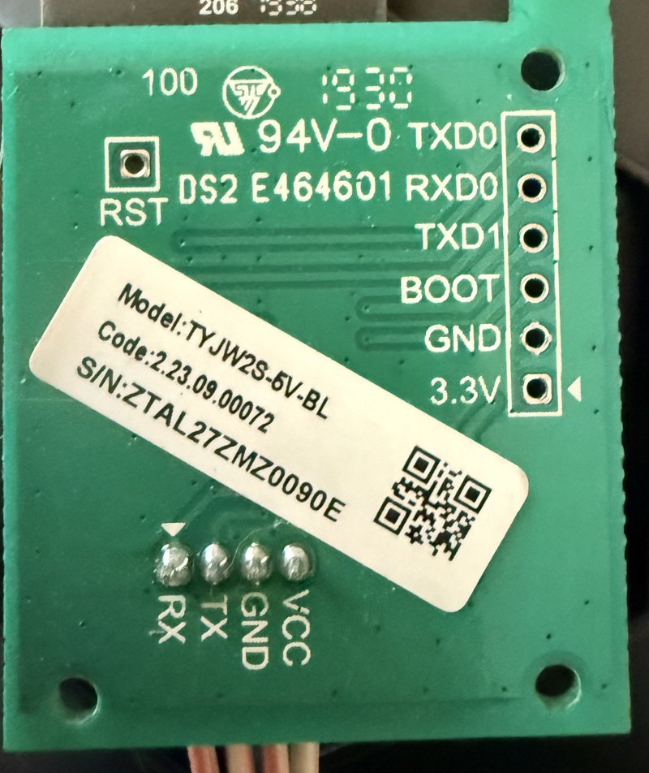

## Overview

The Duux Blizzard Smart (DXMA04, 10K BTU; first-generation Duux "smart" range) is a Tuya
TuyaMCU device. The display board's MCU talks the standard Tuya serial protocol to a small
WiFi carrier board, a **TYJW2S-5V-BL** with a **TYWE1S** module (ESP8266EX, 1 MB flash). The
MCU reports Tuya product ID `zhmv8syot6ye4kjo`, the same one the
[tuya-local](https://github.com/make-all/tuya-local) project calls "Duux Blizzard Smart".

The airco keeps working from its own panel and IR remote without the WiFi board, so the worst
case of flashing is losing the "smart" part.

## Hardware



- **Opening:** remove the screws on the top (left, right, back; hidden under rubber caps) and
  lift the black cover. The WiFi carrier sits behind the control panel and connects to the
  display board with a 4-wire cable.
- **4-pin MCU connector:** `RX · TX · GND · VCC`. **VCC is 5 V** (the carrier has its own 3.3 V
  regulator and level shifting). Never connect a 3.3 V board directly to it.
- **6-pin programming header** (back of the carrier): `TXD0 · RXD0 · TXD1 · BOOT · GND · 3.3V`,
  plus an `RST` pad. `TXD1` = GPIO2 (debug output).
- **The button on the carrier is GPIO0 (BOOT) to GND**, so holding it while powering up enters
  flash mode without extra wiring.

## Flashing

1. Unplug the 4-wire MCU cable from the carrier.
2. Connect a USB-serial adapter **set to 3.3 V** to the 6-pin header: GND, adapter TX → `RXD0`,
   adapter RX → `TXD0`. **Leave the adapter's VCC unconnected.**
3. Power the carrier with **5 V on its own 4-pin connector** (VCC + GND only) from a separate
   source. The 3.3 V output of a typical FT232 breakout (~50 mA) browns out an ESP8266.
4. Hold the carrier's button while applying 5 V, then release.
5. Back up first: `esptool read-flash 0 0x100000 backup.bin`. Then erase and flash.
6. Replug without the button and put the board back.

## GPIO Pinout

| Pin    | Function                                  |
| ------ | ----------------------------------------- |
| GPIO0  | Carrier button (BOOT, to GND)             |
| GPIO1  | TXD0, 6-pin header: flashing only         |
| GPIO2  | TXD1, 6-pin header (debug output)         |
| GPIO3  | RXD0, 6-pin header: flashing only         |
| GPIO13 | Tuya MCU RX                               |
| GPIO15 | Tuya MCU TX                               |

⚠️ **The MCU is on the swapped UART0 pins GPIO15 (TX) / GPIO13 (RX), not on GPIO1/3.** On
GPIO1/3 the MCU never answers the heartbeat (`Initialization failed at init_state 0`). The
Duux Whisper Flex uses the same swapped pins.

## Datapoints

Verified against the front panel, at 9600 baud:

| DP | Type    | Function |
| -- | ------- | -------- |
| 1  | bool    | Power |
| 2  | enum    | Mode: 0 auto · 1 cool · 2 fan · 3 dry (the panel button cycles 0 → 1 → 3 → 2) |
| 3  | enum    | Fan: 0/1/2 = panel speeds 1/2/3 (dry and sleep force speed 1) |
| 4  | int     | Timer, hours (0–24) |
| 5  | int     | Target temperature, °C (18–32) |
| 6  | bool    | Sleep |
| 7  | bool    | Ionizer |
| 8  | int     | Room temperature, °C (what the display shows) |
| 9  | bitmask | Fault: 0 = OK, 1 = water tank full |
| 10 | int     | Target temperature, °F |
| 11 | int     | Room temperature, °F |
| 12 | bool    | Ionizer present |
| 13 | bool    | Heating present (off on this unit) |
| 14 | bool    | °F display |
| 15 | int     | Timer remaining, minutes |

ESPHome's Tuya climate has no *auto* mode, so a unit in auto shows as *cool* there. The `Mode`
select in the configuration below shows and sets all four modes. For a clean "water tank full"
binary sensor, add a template binary sensor on the `Fault code` sensor (`state == 1`) in your own
configuration.

## Basic Configuration

```yaml file=config.yaml
```
