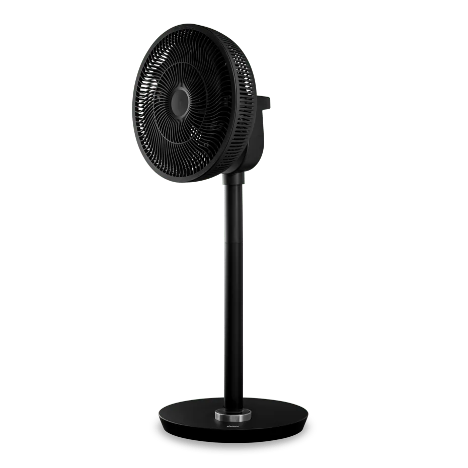

## GPIO Pinout

| Pin    | Function |
| ------ | -------- |
| GPIO00 | Nono     |
| GPIO01 | None     |
| GPIO02 | None     |
| GPIO03 | None     |
| GPIO04 | None     |
| GPIO05 | None     |
| GPIO09 | None     |
| GPIO10 | None     |
| GPIO12 | None     |
| GPIO13 | Tuya Rx  |
| GPIO14 | None     |
| GPIO15 | Tuya Tx  |
| GPIO16 | None     |
| FLAG   | None     |

## Basic Configuration

```yaml file=config.yaml
```
