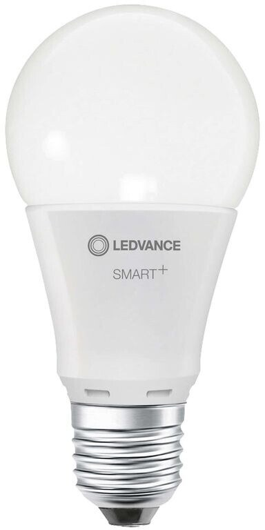

LEDVANCE SMART+ Wi-Fi bulb with adjustable white (warm and cold white on separate PWM channels). Product ID AC42220.

| Parameter     | Value                                           |
|---------------|-------------------------------------------------|
| Product ID    | AC42220                                         |
| Tuya firmware | 1.3.21                                          |
| Module / chip | CB2L / BK7231N                                  |
| ESPHome board | `generic-bk7231n-qfn32-tuya` (or `cb2l`)        |

## Programming

Flashed over the air with [tuya-cloudcutter](https://github.com/tuya-cloudcutter/tuya-cloudcutter) and ESPHome
Kickstart, then the configuration below over OTA. In cloudcutter select the device by firmware version:
**1.3.21** → `oem-bk7231n-light-ty-1.3.21-sdk-2.3.3-40.00`.

Do not update the firmware in the Tuya / LEDVANCE app before flashing - newer versions may close the exploit used by
cloudcutter.

## GPIO Pinout

| Pin | Function                                   |
|-----|--------------------------------------------|
| P7  | PWM warm white (active high, 1000 Hz)      |
| P8  | PWM cold white (active high, 1000 Hz)      |

The pins were read from the original Tuya configuration: OpenBeken → `TuyaConfig` dump, decoded with `bk7231tools`
(`cmod: cw`, `cwtype: 0`, `c_pin: 8`, `w_pin: 7`, `pwmhz: 1000`, `brightmin: 10`).

## Configuration

Add your own `wifi`, `api` and `ota` sections.

```yaml file=config.yaml
```

Without `min_power` the bulb starts to glow only at about 9 % (threshold around 0.8 % PWM duty cycle). A higher value,
e.g. `min_power: 0.1`, breaks the colour at low brightness (2700 K looks white), so the value equals the threshold
itself.
