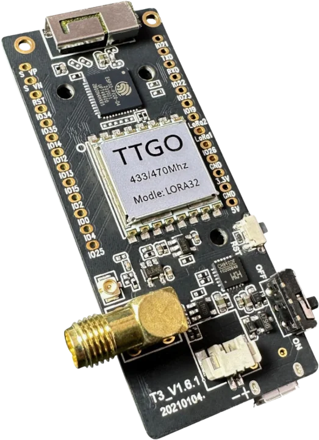

Model reference: T3 LoRa32 V1.6.1

Manufacturer: [LILYGO](https://lilygo.cc/)

## Product Description

The LILYGO T3 LoRa32 V1.6.1 is a development board featuring an ESP32 microcontroller with integrated
WiFi, Bluetooth, and a Semtech SX1276/SX1278 LoRa radio transceiver. It includes a 0.96" OLED display and is
designed for IoT applications requiring long-range wireless communication.

### Key Features

- [ESP32](https://esphome.io/components/esp32/#esp32) dual-core 240MHz processor
- 4MB Flash memory
- [SX1276/SX1278](https://esphome.io/components/packet_transport/sx127x) LoRa radio (433MHz or 868/915MHz variants)
- [SSD1306](https://esphome.io/components/display/ssd1306/#over-ic) 128x64 0.96″ OLED display
- LiPo battery connector with charging circuit
- CP2104 USB-to-UART bridge
- Micro-USB connector
- SD card slot
- WiFi 802.11 b/g/n
- Bluetooth Classic and BLE

## GPIO Pinout

### SX127x radio

| Function | GPIO   |
|----------|--------|
| SPI CLK  | GPIO5  |
| SPI MOSI | GPIO27 |
| SPI MISO | GPIO19 |
| CS       | GPIO18 |
| RST      | GPIO23 |
| DIO0     | GPIO26 |
| DIO1     | GPIO33 |
| DIO2     | GPIO32 |

### OLED display

| Function | GPIO   |
|----------|--------|
| SDA      | GPIO21 |
| SCL      | GPIO22 |

### SD Card slot

| Function | GPIO   |
|----------|--------|
| CS       | GPIO13 |
| MOSI     | GPIO15 |
| MISO     | GPIO2  |
| CLK      | GPIO14 |

### Other

| Function    | GPIO   |
|-------------|--------|
| LED         | GPIO25 |
| Battery ADC | GPIO35 |

## Basic Configuration

```yaml file=config.yaml
```

## LoRa Modulation

Configuration for LoRa modulation:

```yaml file=lora.yaml
```

## FSK Modulation

Configuration for FSK modulation in packet mode:

```yaml file=fsk.yaml
```

## OOK Modulation with Remote Transmitter/Receiver

Configuration for OOK modulation in continuous mode using the remote transmitter and receiver components:

```yaml file=ook.yaml
```

## OLED Display

Configuration to use the onboard 0.96" OLED display:

```yaml file=oled.yaml
```

## Battery Monitoring

Configuration to monitor LiPo battery voltage:

```yaml file=battery.yaml
```

## Links

- [Product Page](https://lilygo.cc/products/lora3)
- [GitHub Repository](https://github.com/Xinyuan-LilyGO/LilyGo-LoRa-Series)
- [Schematic](https://github.com/Xinyuan-LilyGO/LilyGo-LoRa-Series/blob/master/schematic/T3_V1.6.1.pdf)
- [Wiki](https://wiki.lilygo.cc/products/t3-series/t3-lora32)
