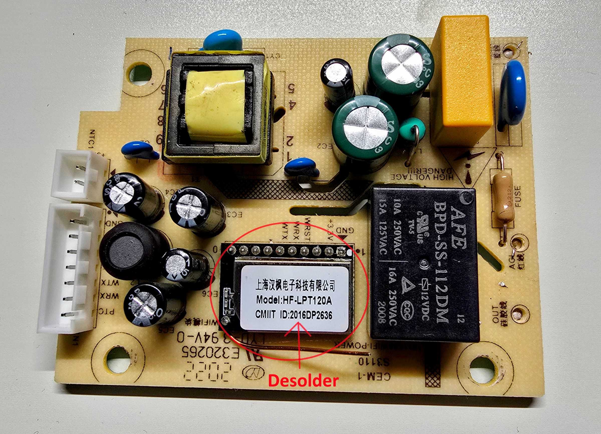
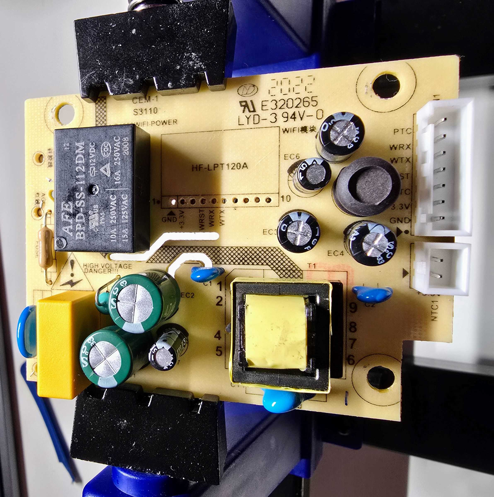
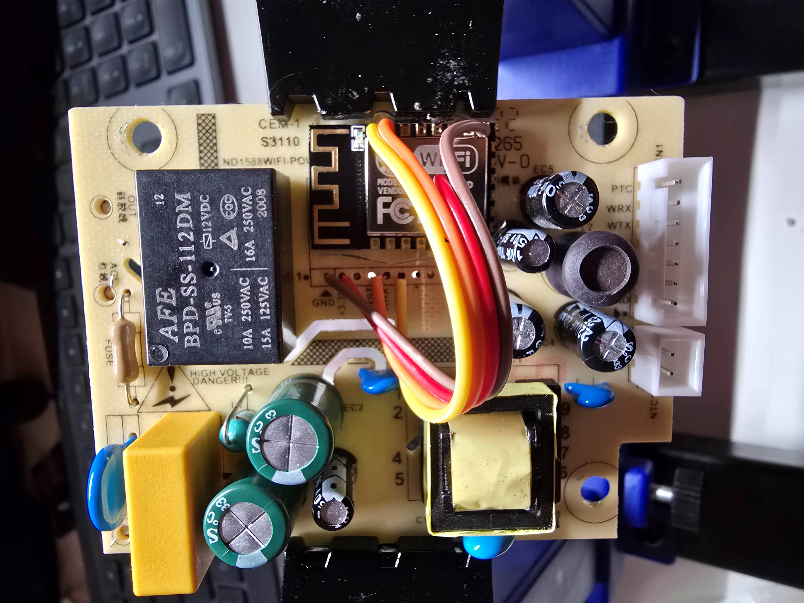

## General Notes

Mill panel heaters are available in various versions. This component is specifically designed for **Generation 2 panel
heaters** (not compatible with portable heater models). Below is a table that helps you determine which generation you
have based on the **Wi-Fi serial number prefix** (originally linked from Mill’s support article):

### Generation overview

| Wi-Fi serial starts with | Generation | Approx. year |
|--------------------------|------------|--------------|
| `SKAG*****`              | 1          | 2016         |
| `SKAH*****`              | 2          | 2017         |
| `SKAI*****`              | 2          | 2018         |
| `SKAJ*****`              | 2          | 2019         |
| `SKAK*****`              | 2          | 2020         |
| `SKAL*****`              | 3 / 3M     | 2021         |
| `SKAN*****`              | 3 / 3M     | 2022         |
| `SKAO*****`              | 3 / 3M     | 2023         |
| `MI***...`               | 3 / 3M     | 2024         |

If you have a **Generation 3** panel heater (which comes with a built-in ESP32), check out this component:
[https://github.com/ssieb/esphome_components/tree/mill/components/mill_heater](https://github.com/ssieb/esphome_components/tree/mill/components/mill_heater)
To use this component with a Generation 2 panel heater, you’ll need to replace the HF-LPT120A module with an ESP8266.


HF-LPT120A desoldered



Solder the ESP8266 in place.
Refer to the **GPIO Pinout section** for detailed instructions



## Installation and UART requirements

Install the component from the dedicated external-component repository:

~~~yaml
external_components:
  - source:
      type: git
      url: https://github.com/owangen/esphome-mill-panelheater-gen2
      ref: main
    components: [mill_panelheater_gen2]
~~~

The component requires a two-way UART connection using **9600 baud, 8 data bits, no parity and 1 stop bit (8N1)**. Both RX and TX must be connected. The GPIO pins below are for the ESP8266 replacement described on this page; change them only when your hardware wiring is different.

## GPIO Pinout

| PIN (mill board) | ESP8266    | Description              |
|------------------|------------|--------------------------|
| +3.3V            | VCC        | Power input (3.3V)       |
| GND              | GND        | Ground                   |
| WTX              | TX (GPIO1) | UART transmitter         |
| WRX              | RX (GPIO3) | UART receiver            |

## Minimal configuration

```yaml
substitutions:
  devicename: "millzero_heater"  #Lower case name
  friendly_name: "Mill Zero heater"

esphome:
  name: "${devicename}"

external_components:
  - source:
      type: git
      url: https://github.com/owangen/esphome-mill-panelheater-gen2
      ref: main
    components: [mill_panelheater_gen2]

esp8266:
  board: d1_mini

wifi:
  ssid: !secret wifi_ssid
  password: !secret wifi_password
  ap:

captive_portal:

# Enable logging
logger:
  baud_rate: 0 # Deactived to prevent conflict with UART, sending UART to mill controller does not work if enabled

# Enable Home Assistant API
api:

ota:

uart:
  id: uart_bus
  tx_pin: GPIO01
  rx_pin: GPIO03
  baud_rate: 9600
  data_bits: 8
  parity: NONE
  stop_bits: 1

climate:
  - platform: mill_panelheater_gen2
    name: Mill heater
    uart_id: uart_bus
```

## Supported features

- Climate modes OFF and HEAT.
- Target temperature control from 5 °C through 35 °C.
- Current temperature reporting.
- Heating, idle and off climate action reporting.
- Power-on and power-off commands.
- Optional estimated power sensor using a configured rated power.
- Communication timeout warning when no valid status frame is received for 150 seconds.

## Estimated power sensor

The heater protocol reports whether the heater is heating, but it does not provide measured wattage. To expose an estimated power sensor, configure both rated_power and power:

~~~yaml
climate:
  - platform: mill_panelheater_gen2
    name: Mill heater
    uart_id: uart_bus
    rated_power: 900
    power:
      name: Mill heater estimated power
~~~

The sensor publishes the configured rated_power while the reported action is heating and 0 W while idle or off. It is an estimate, not an electrical measurement, and must not be used for protection, billing or safety functions.

## Known limitations

- restore_mode is not implemented yet.
- Temperatures are handled at one-degree protocol resolution.
- The power sensor is estimated from rated_power; there is no real-time power measurement.
- The implementation supports the observed Gen2 protocol frames only. Other Mill models, hardware revisions or firmware versions may use different frames.
- Commands are sent and the component waits for a status frame to confirm the resulting state.
- This is not a safety controller and does not provide a hardware disconnect or independent over-temperature protection.

## Reverse-engineering notes

The following observations are based on captured traffic and are not an official Mill protocol specification:

- Serial settings are 9600 8N1.
- Frames start with 0x5A and end with 0x5B.
- The declared frame length is carried in the frame and is used to delimit reception.
- Status frames use command type 0xC9 and are 17 bytes including framing.
- Status data contains target temperature, current temperature, mode and action fields.
- Power and temperature commands use observed payload types 0x06 and 0x22 respectively.
- The checksum is the 8-bit sum of the command/status payload bytes before the checksum field.

The implementation rejects invalid lengths, unsupported status values, invalid checksums and an incorrect frame terminator. The test suite in the external-component repository documents the observed frames in executable form.

## Electrical safety warning

> Mill panel heaters are mains-powered appliances. Do not connect an ESP GPIO, USB-UART adapter or other low-voltage electronics to mains wiring or heater terminals. Only connect to a confirmed low-voltage serial interface using the correct voltage levels, isolation and wiring for the specific heater. Disconnect mains power before opening the appliance. Installation and modification should be performed by a qualified electrician or suitably competent person. You are responsible for safe installation, damage prevention and compliance with local electrical rules.

## Credits

This component builds on the work by:

-
  [JDolven: Replacing HF LPT120A in a Millheat heater](https://github.com/JDolven/Replacing-HF_LPT120A-in-a-millheat-heater)
- [trondsundt: MillHeat ESPHome NodeMCU](https://github.com/trondsundt/MillHeat-ESPHome-NodeMCU)
