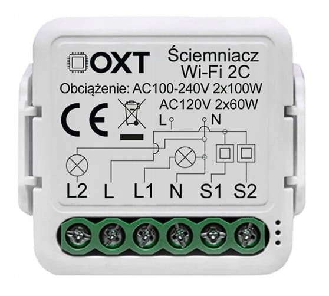

Two-channel in-wall dimmer (2 × 100 W), terminals `L2 L L1 N S1 S2`, Tuya CB3S module (BK7231N) plus one dimming MCU.
The two-channel version of the [OXT 1-ch dimmer](../OXT-1ch-dimmer/).

| Parameter     | Value                                       |
|---------------|---------------------------------------------|
| Tuya firmware | 1.0.1 (main module and MCU)                 |
| Module / chip | CB3S / BK7231N + dimming MCU                |
| ESPHome board | `generic-bk7231n-qfn32-tuya`                |

**This is not a TuyaMCU device** - the ESPHome `tuya` component fails with `Initialization failed at init_state 0`.
The CB3S only transmits commands to the MCU over a one-way UART, and the MCU never answers. The wall switches S1/S2,
the button and the LED are connected to the CB3S, so ESPHome handles them directly.

## Programming

Flashed over the air with [tuya-cloudcutter](https://github.com/tuya-cloudcutter/tuya-cloudcutter) and ESPHome
Kickstart, then the configuration below over OTA. In cloudcutter select the device by firmware version:
**1.0.1** → `zhwfb-double-dimmer-1.0.1-sdk-2.3.3-40.00`.

Do not update the firmware in the Tuya app before flashing - newer versions may close the exploit used by
cloudcutter.

## GPIO Pinout

| Pin | Function                                   |
|-----|--------------------------------------------|
| P6  | LED (active low)                           |
| P8  | S1 (latching wall switch, active low)      |
| P9  | S2 (latching wall switch, active low)      |
| P11 | UART TX to the MCU (9600 8N1)              |
| P24 | Button                                     |

Only P11, P8, P9, P24, P6, CEN, 3V3 and GND are connected on the module. P10 (RX) is not connected to the MCU.

## UART protocol

One 9-byte frame per brightness change:

| Byte | Channel 1  | Channel 2  | Meaning                         |
|------|------------|------------|---------------------------------|
| 1-3  | `0A FF 55` | `0A FF 55` | header                          |
| 4    | `01`       | `02`       | channel                         |
| 5    | level      | `00`       | L1 level (`00` off, `FF` max)   |
| 6    | `00`       | level      | L2 level                        |
| 7-8  | `05 DC`    | `05 DC`    | ramp (about 0.5 s)              |
| 9    | `0A`       | `0A`       | end                             |

Examples: `0A FF 55 01 80 00 05 DC 0A` = L1 about 50 %, `0A FF 55 02 00 80 05 DC 0A` = L2 about 50 %. A frame for
channel 2 does not change channel 1. The MCU does not remember its state after a power loss - the
[oxt_dimmer external component](https://github.com/PrawilnyAlo/esphome-oxt-dimmer) sends the frames and repeats the
last level a few seconds after boot.

## Configuration

Every flip of a wall switch toggles its channel, the button toggles channel 1. Add your own `wifi`, `api` and `ota`
sections.

```yaml file=config.yaml
```

If a bulb starts to glow only above X % of the slider, set `min_power` on its output to X^gamma (default gamma 2.8,
e.g. 44 % → 0.44^2.8 ≈ 0.10) and add `zero_means_zero: true`. Pick it separately for each channel and bulb.
