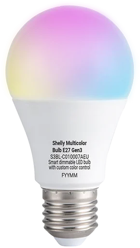
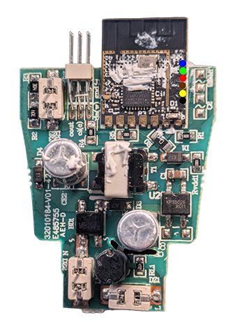

The Shelly Multicolor Bulb E27 Gen3 (`S3BL-C010007AEU`, board marking `RGBCCTBulbG3`) is a Wi-Fi LED bulb with an E27
socket (ESP32-C3, 8 MB flash).

Its LED driver is a **KP18068** (5-channel constant-current driver, 2-wire bus), which ESPHome does not support itself.
The configuration uses an external component for it.



The bulb has red, green and blue LEDs and **one fixed warm white**, so it is an `rgbw` light; cool whites are mixed
from the RGB LEDs.

> **Warning:** The bulb contains a **non-isolated mains power supply**. Never open it or connect a serial adapter while
> it is connected to mains voltage.

## Flashing

### Option 1: OTA from the stock firmware (Free-Shelly-OTA)

The bulb does not have to be opened. The community tool [Free-Shelly-OTA](https://github.com/oxynatOr/free-shelly-ota)
can send an ESPHome image to the bulb while it still runs the Shelly firmware. The steps and the ESPHome settings it
needs are on the tool's
[device page](https://github.com/oxynatOr/free-shelly-ota/blob/main/docs/devices/RGBCCTBulbG3.md).

### Option 2: UART

Open the bulb and connect a 3.3 V USB-to-serial adapter to the pads on the edge of the module. The colour is the marker
in the picture. Take the bulb out of the socket and power it only from the adapter.



| Function        | Colour |
| --------------- | ------ |
| TXD             | Blue   |
| RXD             | Green  |
| 3V3             | Red    |
| CHIP_PU         | Brown  |
| BOOT (GPIO9)    | Yellow |
| GND             | Black  |

TXD and RXD are named from the chip's point of view: connect TXD to RX and RXD to TX of the adapter. To enter download
mode, connect BOOT to GND while powering on and release it after the chip has started.

As always, first take a dump!

```bash
esptool --chip esp32c3 --port COM11 --baud 460800 read_flash 0x0 0x800000 shelly_multicolor_bulb_gen3.bin
```

Then flash the `firmware.factory.bin` of your build to `0x0`:

```bash
esptool --chip esp32c3 --port COM11 --baud 460800 write_flash 0x0 firmware.factory.bin
```

## GPIO Pinout

| Pin    | Function                         |
| ------ | -------------------------------- |
| GPIO4  | LED driver data (SDA)            |
| GPIO5  | LED driver clock (SCL)           |
| GPIO9  | BOOT (download mode, low-active) |
| GPIO20 | UART RX (console, logger)        |
| GPIO21 | UART TX (console, logger)        |

| LED driver output | LED                        |
| ----------------- | -------------------------- |
| OUT1              | Blue                       |
| OUT2              | Red                        |
| OUT3              | Green                      |
| OUT4              | Warm white                 |
| OUT5              | No visible effect          |

The Shelly firmware writes the same value to OUT4 and OUT5; the configuration leaves OUT5 unused.

## Configuration

The external component bit-bangs the two driver pins, so there is no `i2c:` block. The driver currents are the values
of the Shelly firmware (9 mA colours, 27.5 mA white). The white is driven on OUT4.

```yaml file=config.yaml
```

Slider values below about 7 % round to zero (10-bit driver plus gamma correction 2.8), so the lowest steps stay dark.
On the bulb all colours and the warm white switch on at 7 %, and the bulb does not flicker. A minimum output
(`min_power` with `zero_means_zero: true` on the outputs) would avoid the dark steps.

## Optional: Tuning

The settings below are starting points and not tested on the bulb. Change one thing at a time.

- **Driver current:** `rgb_current` (9 mA) and `cw_current` (27.5 mA) are the values the Shelly firmware writes; they
  were not measured. Do not raise them without knowing the LEDs: too high can overheat the bulb or make it too bright,
  too low makes it dark. The defaults of the component (22.5 mA and 75 mA) are not values for this bulb.
- **White balance:** The light is `rgbw` with one fixed warm white, so there are no colour temperature settings. To
  correct a colour cast or the mix of the white by eye, add `color_correct: [R%, G%, B%, W%]` to the light. Each value
  scales one channel; a value below 100 % lowers that channel.
- **Low end:** Besides `min_power` (see above), a lower `gamma_correct` on the light (default 2.8) lets small slider
  values reach the driver as larger numbers, so the lowest steps no longer round to zero.
- **Dimming method:** The configuration uses `rgb_dimming: analog` (the current amplitude of the colour outputs is
  changed) and `chop_frequency: 4khz`. If a bulb flickers at low brightness, try `rgb_dimming: chop` (the duty cycle
  is changed). `chop_frequency` can be `4khz`, `2khz`, `1khz` or `500hz`.
