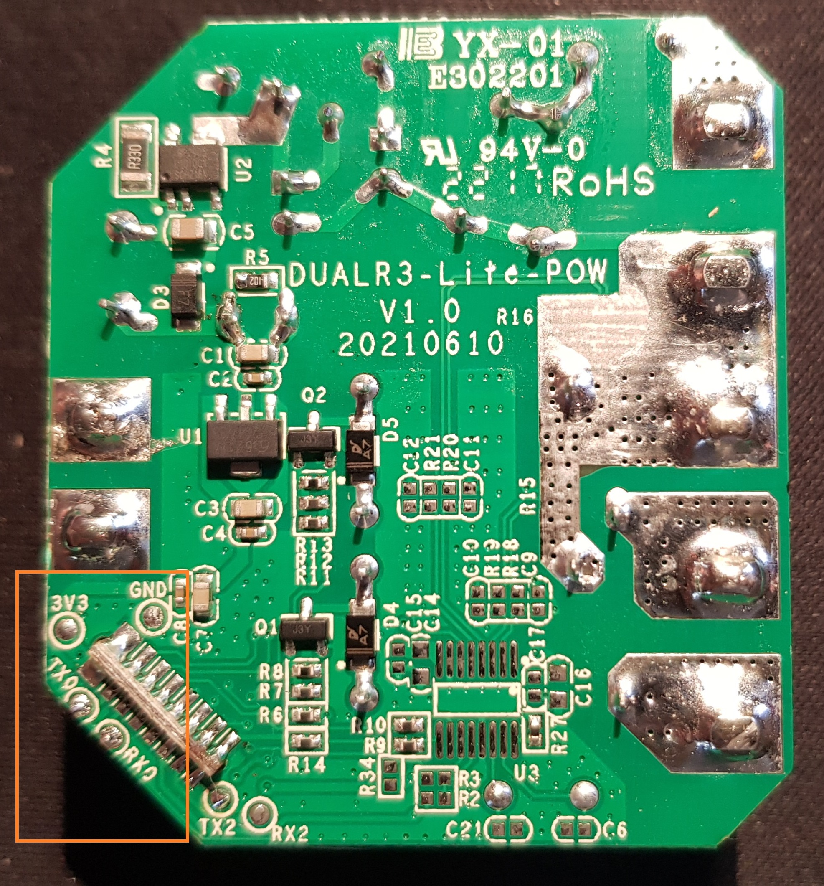

## Product Images



## GPIO Pinout

### Sonoff Dual R3 Lite - PCB version 1.x

| Pin    | Function                   |
| ------ | -------------------------- |
| GPIO13 | Status LED (blue/inverted) |
| GPIO00 | Push Button (inverted)     |
| GPIO27 | Relay 1 / LED 1 (red)      |
| GPIO14 | Relay 2 / LED 2 (red)      |
| GPIO32 | Switch 1 (inverted)        |
| GPIO33 | Switch 2 (inverted)        |

### Sonoff Dual R3 - PCB version 1.x,2.x

| Pin    | Function                   |
| ------ | -------------------------- |
| GPIO13 | Status LED (blue/inverted) |
| GPIO00 | Push Button (inverted)     |
| GPIO27 | Relay 1 / LED 1 (red)      |
| GPIO14 | Relay 2 / LED 2 (red)      |
| GPIO32 | Switch 1 (inverted)        |
| GPIO33 | Switch 2 (inverted)        |
| GPIO25 | power sensor UART Tx       |
| GPIO26 | power sensor UART Rx       |

For power measuring see CSE7761 Power Sensor (v1.x) or BL0939 Power Sensor (v2.x)

## Basic Configuration

```yaml file=config.yaml
```

Dual R3 v1.x power meter configuration. Since ESPHome 2026.5.0 the CSE7761 reports signed power, and on this board
normal loads read negative without the `multiply: -1` filters
([details](https://esphome.io/components/sensor/cse7761/#power-direction)).

```yaml file=power-meter-cse7761.yaml
```

Dual R3 v2.x power meter configuration

```yaml file=power-meter-bl0939.yaml
```
