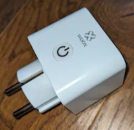
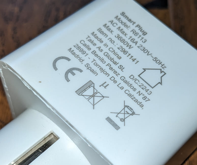

## Notes





## GPIO Pinout

| Pin | Function      |
| --- | ------------- |
| P6  | LED           |
| P7  | Button        |
| P8  | Relay         |
| P11 | SEL           |
| P24 | CF1           |
| P26 | CF            |


## Board Configuration

```yaml
esphome:
  name: woox-r6113
  friendly_name: WOOX Smart Plug
  on_boot:
    priority: -100
    then:
      - if:
          condition:
            lambda: 'return id(saved_relay_state);'
          then:
            - switch.turn_on: relay
          else:
            - switch.turn_off: relay
            
bk72xx:
  board: generic-bk7231n-qfn32-tuya

logger:

wifi:
  ssid: !secret wifi_ssid
  password: !secret wifi_password

globals:
  - id: saved_relay_state
    type: bool
    restore_value: yes
    initial_value: 'false'

switch:
  - platform: gpio
    id: relay
    name: "Relay"
    pin: P8
    restore_mode: ALWAYS_OFF
    on_turn_on:
      - globals.set:
          id: saved_relay_state
          value: 'true'
      - light.turn_on: plug_led
    on_turn_off:
      - globals.set:
          id: saved_relay_state
          value: 'false'
      - light.turn_off: plug_led

light:
  - platform: binary
    id: plug_led
    output: plug_led_output
    internal: true        

binary_sensor:
  - platform: gpio
    name: "Button"
    id: woox_button
    pin:
      number: P7
      mode:
        input: true
        pullup: true
      inverted: false
    filters:
      - delayed_on: 30ms
      - delayed_off: 30ms
    internal: true  
    on_press:
      then:
        - switch.toggle: relay

output:
  - platform: gpio
    id: plug_led_output
    pin:
      number: P6
      inverted: false

web_server:
  port: 80   

sensor:
  - platform: hlw8012
    model: BL0937
    voltage_divider: 829
    current_resistor: 0.0011707441386340468
    
    sel_pin:
      number: P11
      inverted: true

    cf_pin:
      number: P26
      inverted: true

    cf1_pin:
      number: P24
      inverted: true

    current:
      name: "Current"
      filters:
        - multiply: 0.5322126205722884

    voltage:
      name: "Voltage"

    power:
      name: "Power"
      id: power

    energy:
      name: "Energy"

    initial_mode: CURRENT
    change_mode_every: 4
    update_interval: 10s

  - platform: integration
    name: 'Total Energy'
    id: total_power
    sensor: power
    time_unit: h
    restore: true
    state_class: total_increasing
    device_class: energy
    filters:
        - multiply: 0.001
    unit_of_measurement: kW
```
