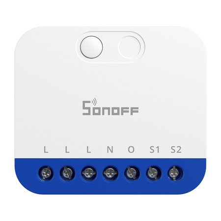
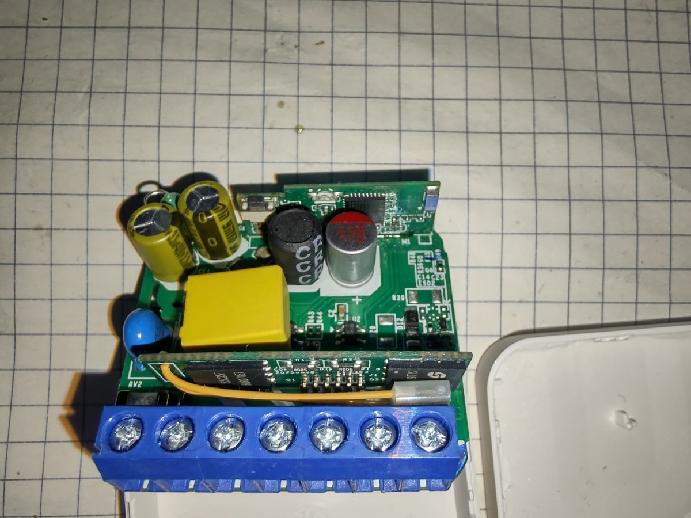
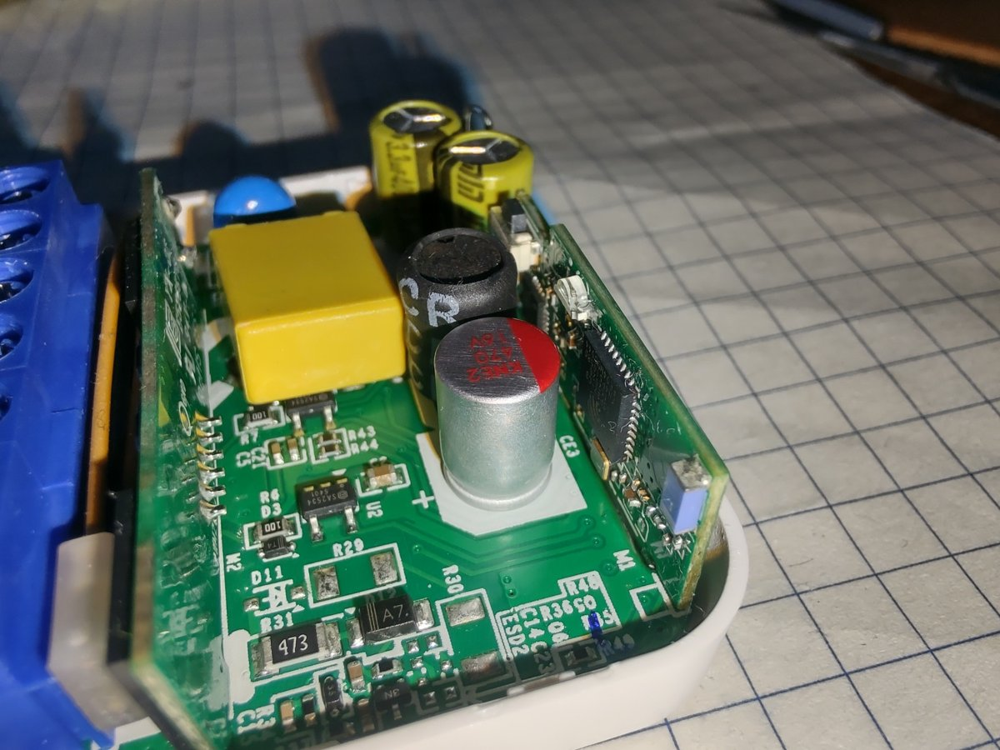
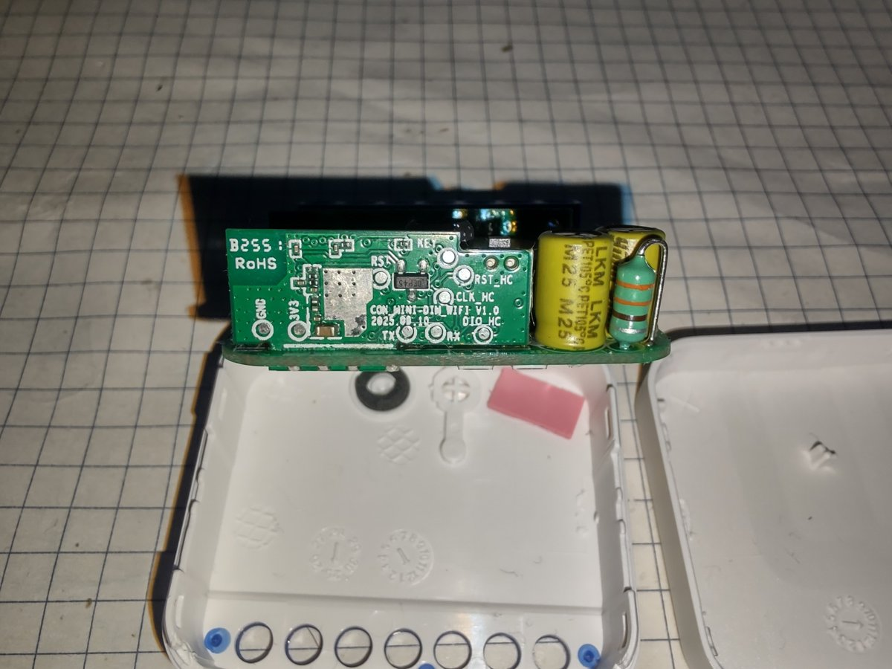

Sonoff MINI Extreme dimmer (MINI-DIM), Matter over Wi-Fi. Trailing / leading edge, max 400 W resistive / 200 VA LED,
one on-board button, two external switch inputs (S1, S2), power metering.

Product page:
[https://sonoff.tech/products/sonoff-mini-extreme-matter-over-wifi-dimmer-switch-mini-dim](https://sonoff.tech/products/sonoff-mini-extreme-matter-over-wifi-dimmer-switch-mini-dim)

## Features

- ESP32-C3 (Wi-Fi, button, LED, S1/S2 inputs) - Secure Boot v2 and flash encryption enabled
- HC32L021 (Cortex-M0+) controlling the power stage (two MOSFETs), metering and calibration,
  connected to the ESP32-C3 over UART
- PCB: `CON_MINI-DIM_WIFI V1.0`

## Programming

Like the [Sonoff MINI R4M](../Sonoff-MINIR4M/), the original ESP32-C3 cannot be reflashed: Secure Boot v2 and
flash encryption are enabled (bootloader log: "0 plaintext flashes left").

**The ESP32-C3 IC has to be replaced** with a new one running ESPHome. What worked:

1. Get an ESP32-C3 SuperMini board (USB-C) - its ESP32-C3 has the 4 MB flash integrated in the package.
2. Flash ESPHome on the SuperMini over USB (esptool or ESPHome). Check that it boots and connects to Wi-Fi.
3. Desolder the small logic board (ESP32-C3 + HC32L021) from the Sonoff power board.
4. Desolder the original ESP32-C3 from the logic board.
5. Desolder the ESP32-C3 from the SuperMini and solder it onto the Sonoff logic board.
6. Solder the logic board back onto the power board.

**Note:** after flashing, USB on the SuperMini stops responding. This is expected - GPIO18/GPIO19 are the USB D-/D+
pins, and the configuration uses them as the UART to the HC32. Make sure Wi-Fi works before moving the chip.
Later updates go over OTA, or through the `TX` / `RX` service pads with `KEY` pulled to GND.

The HC32L021 stays untouched - ESPHome talks to it using the
[sonoff_minidim external component](https://github.com/PrawilnyAlo/esphome-sonoff-minidim), which implements the
reverse engineered protocol ([PROTOCOL.md](https://github.com/PrawilnyAlo/esphome-sonoff-minidim/blob/main/PROTOCOL.md)).

The logic board has service pads for the ESP: `3V3`, `GND`, `TX`, `RX`, `RST` and `KEY` (GPIO9, pull to GND for
download mode), plus `RST_HC`, `CLK_HC`, `DIO_HC` for the HC32.





> **Warning:** the low voltage side is not isolated from mains. Flash and test only from a 3.3 V supply,
> never with 230 V connected.

## GPIO Pinout

| Pin    | Function                                   |
|--------|--------------------------------------------|
| GPIO03 | Blue LED                                   |
| GPIO04 | S1 (external switch input, 230 V)          |
| GPIO05 | S2 (external switch input, 230 V)          |
| GPIO09 | Button                                     |
| GPIO10 | HC32 reset (`RST_HC`)                      |
| GPIO18 | UART TX to HC32 (`CLK_HC`)                 |
| GPIO19 | UART RX from HC32 (`DIO_HC`)               |
| GPIO20 | RX (service pad)                           |
| GPIO21 | TX (service pad)                           |

UART to the HC32: 115200 baud, 8N1.

## Configuration

Hardware configuration: light with fades done by the HC32, power / voltage / current, button, S1 as a rocker
switch, status LED. Add your own `wifi`, `api` and `ota` sections.

```yaml file=config.yaml
```

A full example with switch modes (rocker, one or two momentary buttons), auto and manual calibration, transition
time, leading/trailing edge, load type and the original button / LED behaviour (3 clicks, 10 s hold for calibration,
15 s for factory reset) is in the component repository:
[example/sonoff-mini-dim.yaml](https://github.com/PrawilnyAlo/esphome-sonoff-minidim/blob/main/example/sonoff-mini-dim.yaml).
